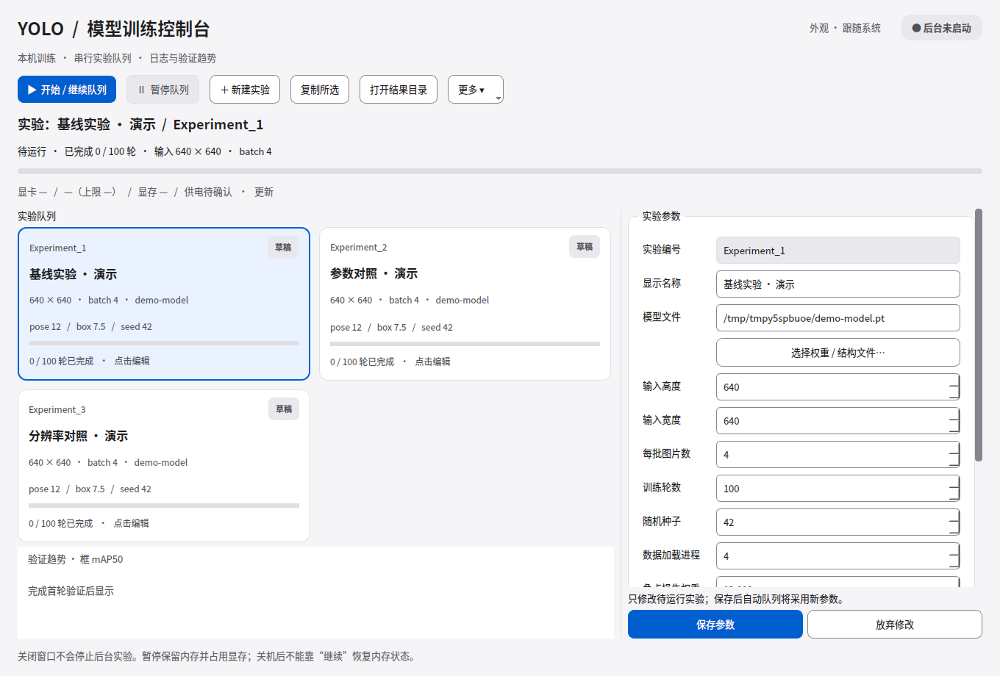

# 可视化的yolo模型训练控制台

Linux 桌面上的 YOLO 实验工作台。每个实验一张卡片，可编辑参数、加入串行队列、暂停或继续训练，查看轮次、日志和验证趋势。



预览使用演示实验，不包含真实训练数据。

## 功能

- 实验卡片、参数编辑、复制草稿；启动后的参数锁定。
- 串行队列，暂停时保留训练进程和显存；关闭界面后后台继续。
- 训练轮次、轮内进度、框 mAP50 曲线、实时日志。
- NVIDIA 温度、功耗和显存显示；笔记本断电或温度过高时暂停。
- 浅色和深色跟随 GNOME 系统外观。
- 本机有共享 GlassMenu 时复用；未安装时使用标准 Qt 菜单，训练功能不依赖它。

当前支持 Ultralytics detection / pose。需要 Linux、Python 3.10+；暂停功能使用 Linux 进程信号。训练数据和模型由使用者提供。

## 安装与启动

```bash
python3 -m venv .venv
.venv/bin/pip install -r requirements.txt -r requirements-training.txt
.venv/bin/python configure.py --data /absolute/path/data.yaml --model /absolute/path/model.pt
.venv/bin/python launch.py
```

配置程序创建 `training.json`、`experiments.json` 和状态目录，已有配置不会被覆盖。实验默认是未加入队列的草稿。确认模型、数据与参数后，勾选「加入自动队列」、保存，再点击开始。

可用独立训练环境：启动前设置 `YOLO_TRAIN_PYTHON=/absolute/path/to/training-venv/bin/python`，界面仍使用有 PyQt6 的 Python。`training.json` 的 `device` 默认为 `0`；可改为 `cpu`。温度显示目前读取 NVIDIA GPU 0。

## 使用

**新建 / 复制所选** 创建草稿；**保存参数** 写入实验配置。运行中、评估中、完成后的实验锁定，可复制后修改。

**开始 / 继续队列** 运行已启用实验；**暂停队列** 向当前训练进程组发送暂停信号，不释放显存。关闭窗口不终止后台。关机后不支持用继续按钮恢复内存状态；从 checkpoint 恢复需要单独准备续训任务。

权重、训练日志和结果在 `state/`。失败会停止队列并保留现场。请勿同时开启旧调度器或手工覆盖状态文件。

后台每五秒采样供电与温度，达到 87°C 暂停，降到 80°C 后继续；手动暂停优先。没有可读的温度数据时仅显示缺失，不把它当作温度正常的证明。

## 评估范围

曲线及结果来自 Ultralytics 框架验证，不代表固定置信度阈值下重新匹配的 Precision / Recall，也没有内置 RM 专用角点 RMSE 或实物 PnP 验收。需要这些指标时另接任务评估器。

当前 worker 固定 FP32、关闭常用随机增强，支持自定义高宽；派发前检查模型任务和数据配置，数据标签、首批前反传和内存可用性由训练启动时的框架检查。大分辨率或大 batch 应先用小任务验证。

## 开发与测试

```bash
QT_QPA_PLATFORM=offscreen .venv/bin/python -m unittest discover -s experiment_ui -p 'test_*.py'
```

测试使用临时数据，覆盖参数锁定、队列、进程身份、真实子进程暂停和继续、界面编辑、系统主题与菜单回退。训练环境基于 `ultralytics==8.4.204`；第三方依赖遵循各自许可。

仓库不包含数据集、权重、私有训练结果、账号凭据或本机配置。
